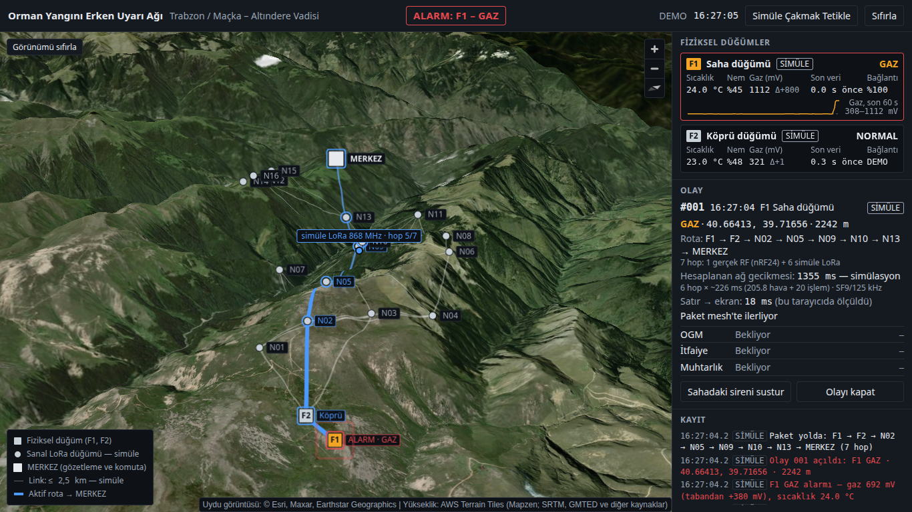
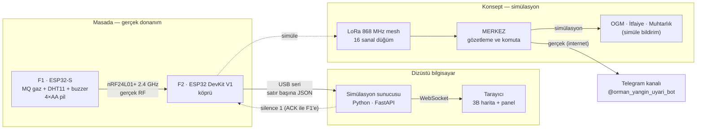
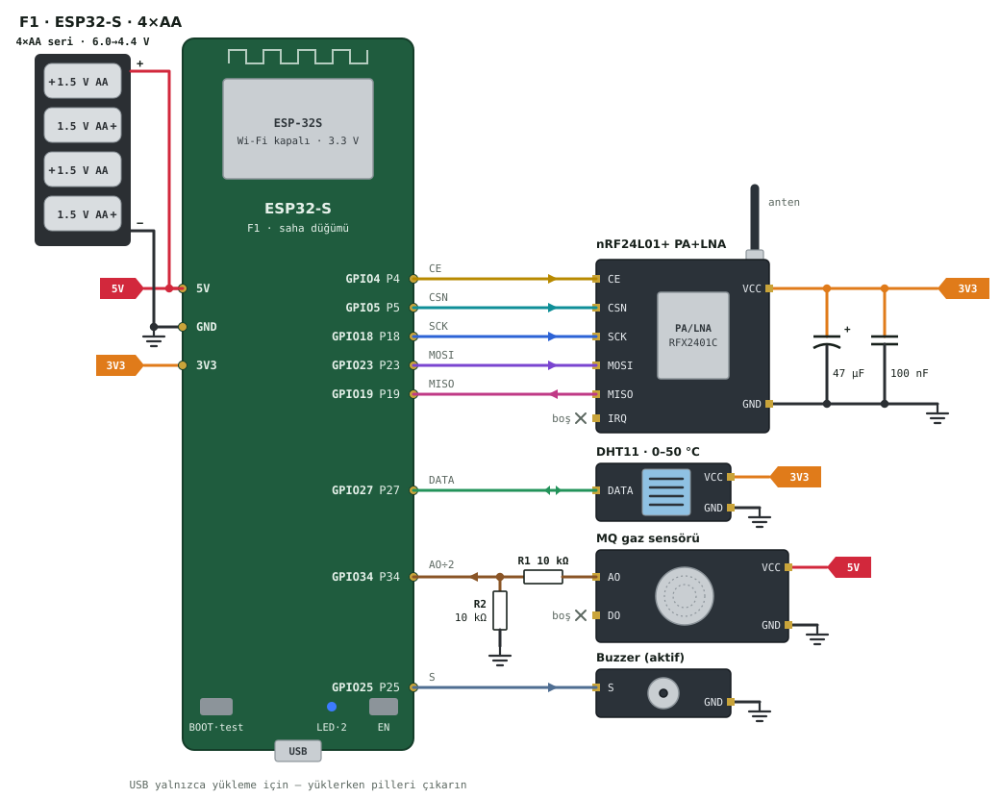

# Orman Yangını Erken Uyarı ve Haberleşme Mesh Ağı

**Hardware-in-the-Loop hackathon demosu** · Trabzon / Maçka – Altındere Vadisi

Orman yangınlarında ilk dakikalar belirleyicidir; ama yangının çıktığı yamaçta çoğu zaman ne mobil şebeke ne de
gözetleyen biri vardır. İhbar geldiğinde yangın büyümüş olur ve ekipler yeri tarif etmekte zorlanır.

Bu projede sahaya bırakılan pilli sensör düğümleri gaz ve sıcaklık anomalisini **saniyeler içinde** algılar,
yerinde siren çalar ve uyarıyı düğümden düğüme atlayan bir radyo ağıyla (mesh) internet çıkışı olan bir merkeze
taşır; merkez koordinat, rakım ve rotayla birlikte ilgili kurumlara bildirir. Demoda iki **gerçek** düğüm (F1 saha
sensörü, F2 köprü) masadadır; geri kalan LoRa mesh ağı, **gerçek arazi verisi** (DEM) üzerinde 3B haritada
simüle edilir ve hangi adımın gerçek, hangisinin simülasyon olduğu ekranda her zaman yazar.



---

## İçindekiler

[Mimari](#mimari) · [Donanım](#donanım) · [Hızlı başlangıç — Linux](#hızlı-başlangıç--linux-ubuntu) ·
[Hızlı başlangıç — Windows](#hızlı-başlangıç--windows) · [Firmware yükleme](#firmware-yükleme) ·
[Çalıştırma modları](#çalıştırma-modları) · [Telegram bildirimi](#telegram-bildirimi) ·
[Demo öncesi kontrol listesi](#demo-öncesi-kontrol-listesi) ·
[Jüri demosu](#jüri-demosu-adım-adım) · [Sorun giderme](#sorun-giderme) · [Proje yapısı](#proje-yapısı) ·
[Teknik notlar](#teknik-notlar) · [Düğüm koordinatları](#düğüm-koordinatları) · [Lisans](#lisans)

## Mimari



Ayrıntılar: [`docs/ARCHITECTURE.md`](docs/ARCHITECTURE.md) · protokol: [`docs/PROTOCOL.md`](docs/PROTOCOL.md)

## Donanım

Tam belge: [`docs/HARDWARE.md`](docs/HARDWARE.md) · etkileşimli şema (çevrimdışı açılır): [`docs/kablolama.html`](docs/kablolama.html)

İki düğüm **aynı kablolanır**; tek fark besleme: **F1 → 4×AA kalem pil → 5V/VIN**, **F2 → yalnızca USB** (pil yok).

| Modül | Pin | ESP32 GPIO | Not |
|---|---|---|---|
| nRF24L01+PA+LNA | VCC / GND | 3V3 / GND | **Asla 5V değil**; 47 µF + 100 nF modül dibinde |
| | CE · CSN · SCK · MOSI · MISO | 4 · 5 · 18 · 23 · 19 | IRQ boş |
| DHT11 | DATA | 27 | VCC 3V3 |
| MQ gaz modülü | AO | 34 (AO → 10 kΩ → GPIO34 → 10 kΩ → GND) | VCC 5V/VIN, DO bağlanmaz |
| Buzzer | + | 25 | aktif buzzer |
| Durum LED'i | — | 2 | kart üstü |



## Hızlı başlangıç — Linux (Ubuntu)

```bash
sudo apt install python3 python3-venv git
```

```bash
git clone https://github.com/Nogeday/orman-yangini-erken-uyari.git
```

```bash
cd orman-yangini-erken-uyari
```

Seri port izni (bir kez; sonra oturumu kapatıp açın) ve CH340 kartlarını kapan `brltty` paketini kaldırma:

```bash
sudo usermod -aG dialout $USER
```

```bash
sudo apt remove brltty
```

Çalıştırma — tek komut. İlk seferde `simulation/.venv` oluşturulur ve bağımlılıklar kurulur (internet gerekir),
sonra sunucu açılır ve tarayıcı `http://127.0.0.1:8000` adresinde açılır:

```bash
python3 simulation/run.py
```

Kart takılı değilse sistem kendiliğinden **DEMO** moduna geçer ve 3 s'de bir port taramaya devam eder; köprü
takılınca otomatik olarak donanım moduna döner. Alternatif sarmalayıcı: `bash simulation/run.sh`.

## Hızlı başlangıç — Windows

1. Python 3.10+ kurun: <https://www.python.org/downloads/> (kurulumda **“Add python.exe to PATH”** işaretli olsun;
   `py` başlatıcısı varsayılan olarak gelir).
2. USB-seri sürücüsü: kartın çipine göre **CH340** (WCH, `CH341SER.EXE`) ya da **CP210x** (Silicon Labs VCP).
   Aygıt Yöneticisi → *Bağlantı noktaları (COM ve LPT)* altında `USB-SERIAL CH340 (COM5)` gibi görünmeli.
3. Depoyu indirin (Git ya da GitHub → *Code → Download ZIP*) ve klasörde PowerShell / Komut İstemi açın:

```powershell
py simulation\run.py
```

Ya da `simulation\run.bat` dosyasına çift tıklayın. Port “meşgul / erişim reddedildi” derse Arduino IDE seri
monitörünü ya da `pio device monitor`'ü kapatın: port aynı anda tek programa açılır.

## Firmware yükleme

**PlatformIO** (önerilen; `pip install platformio` ya da VS Code eklentisi):

```bash
cd firmware/node1_sensor && pio run -t upload
```

```bash
cd firmware/node2_gateway && pio run -t upload
```

Port seçmek için `--upload-port /dev/ttyUSB0` (Windows: `COM5`). F1'e yüklerken **pilleri çıkarın**.

**Arduino IDE 2:** Kart yöneticisinden *esp32 by Espressif*; kütüphane yöneticisinden **RF24** (TMRh20) ve
**DHT sensor library** (Adafruit, bağımlılıklarıyla). İlgili `main.cpp` içeriğini yeni bir sketch'e yapıştırın.
Kart: F1 için *ESP32 Dev Module*, F2 için *DOIT ESP32 DEVKIT V1*.

Açılışta **1 kısa bip** = hazır, **3 kısa bip** = nRF24 bulunamadı. Karta gerek olmadan firmware mantık testleri:
`bash firmware/test_host/run.sh` · donanım seri testi: `python firmware/tools/seri_test.py`.

## Çalıştırma modları

| Mod | Komut | Ne yapar |
|---|---|---|
| Otomatik (varsayılan) | `python3 simulation/run.py` | Köprüyü arar; yoksa DEMO, takılınca donanım |
| Donanım | `python3 simulation/run.py --source serial [--port /dev/ttyUSB0]` | Yalnızca donanım; yoksa “Donanım aranıyor…” ve ipuçları |
| Demo | `python3 simulation/run.py --source demo` | Sanal F1 + F2 (firmware mantığının Python eşi, aynı satır biçimi) |
| Replay | `python3 simulation/run.py --source replay [--replay-file docs/ornek_seri_kayit.tsv] [--loop]` | Kaydı kayıttaki zamanlamayla oynatır |

Diğer bayraklar: `--baud 115200`, `--http-port 8000` (doluysa sonraki boş port), `--host 127.0.0.1`,
`--no-browser`, `--area <bölge.json>`, `--no-log`. Her oturumun ham satırları
`simulation/data/logs/oturum-YYYYMMDD-HHMMSS.jsonl` dosyasına yazılır ve aynı `--replay-file` ile yeniden oynatılabilir.

Harita köşesindeki **Uydu | Topo** düğmesi taban katmanı değiştirir (seçim tarayıcıda hatırlanır). Topo katmanı
(OpenTopoMap) varsayılan önbelleğe alınmaz; çevrimdışı gerekiyorsa `prefetch_tiles.py --layers dem,imagery,topo`.

**Simüle Çakmak Tetikle** her modda çalışır ve aynı ayrıştırıcıdan, aynı olay akışından geçer. Donanım bağlıyken
F1'in yerine ~45 s'lik geçici bir sanal F1 koşar; kayıtta ve kartta **SİMÜLE** yazar. Bu sırada gerçek F1'den alarm
gelirse simülasyon hemen durur.

Testler (önce bir kez `simulation/.venv/bin/python -m pip install -r simulation/requirements-dev.txt`):
`simulation/.venv/bin/python -m pytest simulation/tests` — Windows'ta `simulation\.venv\Scripts\python -m pytest simulation\tests`.

## Telegram bildirimi

Olay MERKEZ'e ulaştığı anda MERKEZ, ekibin Telegram kanalına **gerçek** bir mesaj ve konum iğnesi gönderir
(botumuz `@orman_yangin_uyari_bot`). OGM / İtfaiye / Muhtarlık bildirimleri simülasyon olarak kalır; gerçek
kurumlara hiçbir şey gönderilmez. Alarm GAZ → YANGIN yükselince ve operatör “Olayı kapat” deyince de kanala kısa
bir mesaj gider. Olay panelinde dört satır vardır: üç kurum “(simülasyon)”, Telegram kanalı “(gerçek)”.

**Kurulum (bir kez)**

1. Telegram'da @BotFather → `/newbot` → token'ı alın.
2. Kanal → Yöneticiler → botu ekleyin; **“Mesaj gönderme”** yetkisi açık olsun.
3. `simulation/.env.example` dosyasını `simulation/.env` olarak kopyalayın ve token'ı yazın:
   `TELEGRAM_BOT_TOKEN=123456789:AA…` (boşluksuz, tırnaksız). `.env` git'e girmez.

```bash
cp simulation/.env.example simulation/.env
```

```powershell
copy simulation\.env.example simulation\.env
```

4. Kanal kimliğini bulun ve `.env`'e `TELEGRAM_CHAT_ID=-100…` olarak yazın (tipi `channel` olan satır):

```bash
simulation/.venv/bin/python simulation/tools/telegram_test.py --sohbetler
```

```powershell
simulation\.venv\Scripts\python simulation\tools\telegram_test.py --sohbetler
```

**Test (demo öncesi):** kısa bir bağlantı mesajı, ardından demodaki olay mesajının aynısı (konum iğnesiyle).

```bash
simulation/.venv/bin/python simulation/tools/telegram_test.py
```

```bash
simulation/.venv/bin/python simulation/tools/telegram_test.py --ornek
```

Windows'ta aynı komutlar: `simulation\.venv\Scripts\python simulation\tools\telegram_test.py` (ve `--ornek`).

- Token sızarsa: @BotFather → `/revoke`, yeni token'ı `.env`'e yazın.
- İnternet yoksa demo aynen sürer; olay panelindeki Telegram satırı “Hata: …” gösterir, kayıtta Türkçe ipucu yazar.
- `.env`'de ayar yoksa özellik kapalıdır ve satır hiç görünmez. Testler kanala hiçbir zaman mesaj göndermez.

## Demo öncesi kontrol listesi

- [ ] **İnternet varken bir kez:** `python3 simulation/run.py --no-browser` (bağımlılıklar) ve
      `python3 simulation/tools/prefetch_tiles.py` (bölge için ~1550 karo, ~70 MB). Sonra Wi-Fi'ı kapatıp haritayı deneyin.
- [ ] F1'e **yeni 4×AA** pil (yedek set yanınızda); açılışta 1 bip.
- [ ] F2 doğrudan dizüstüne takılı (hub değil); üst çubukta `Donanım: /dev/ttyUSB0` (ya da `COM5`).
- [ ] MQ sensörü **en az 3 dakika** ısınsın (firmware ilk 45 s gaz alarmı vermez; kartta `ISINIYOR` rozeti söner).
- [ ] Bir kez “Sahadaki sireni sustur” deneyin: kayıtta `F1 onayladı: siren susturuldu` görünmeli.
- [ ] `telegram_test.py` başarılı (salon interneti ya da telefon hotspot'u).
- [ ] Tarayıcı tam ekran (F11); projeksiyonda 1920×1080, dizüstünde 1366×768 test edildi.
- [ ] Her şey ters giderse: **Simüle Çakmak Tetikle** aynı akışı donanımsız oynatır.

## Jüri demosu adım adım

1. Ekranda F1 ve F2 haritanın güneydoğu ucunda, gerçek dağ sırtlarında; ağ kuzeybatıdaki MERKEZ'e uzanıyor.
2. Çakmağı **yakmadan** gaz düğmesine 1–2 s basın, F1'in MQ sensörüne 2–3 cm'den tutun.
   F1 buzzer'ı anında öter, F2 iki kısa bip çalar (kablosuz teslimin sesi).
3. Haritada F1 **kırmızı çerçeve ve halkayla “ALARM · GAZ”** olur; üst çubukta `ALARM: F1 – GAZ`. Olay panelinde
   “Satır → ekran: … ms (bu tarayıcıda ölçüldü)” satırı, satırın bilgisayara gelişinden ekrana yansımasına kadar
   geçen gerçek süreyi gösterir (hedef ≤ 150 ms).
4. Paket F1 → F2 (**gerçek RF · nRF24 2.4 GHz**) → sanal düğümler (**simüle LoRa 868 MHz**) → MERKEZ yolunu hop hop
   izler. Panelde rota ve **hesaplanan ağ gecikmesi** (LoRa hava süresi modeli, “simülasyon”) yazar.
5. MERKEZ alınca OGM, İtfaiye ve Muhtarlık sırayla “Gönderiliyor…” → “İletildi (simülasyon)” olur. Aynı anda ekibin
   Telegram kanalına **gerçek** mesaj ve konum iğnesi gider: telefonda görünür, panelde “Gönderildi · 0.6 s (gerçek)”.
6. **Sahadaki sireni sustur** → F1'in buzzer'ı bir sonraki pakette susar ve ekranda
   “F1 onayladı: siren susturuldu” yazar — bilgisayardan sahaya çift yönlü bağlantının kanıtı.
7. (İsteğe bağlı) 30 s sonra yanan çakmağı DHT11'in ~5 cm altında 5–10 s tutun → **YANGIN** (gaz + ısı); olay güncellenir.
8. (İsteğe bağlı) Rotadaki bir sanal düğüme tıklayıp **Devre dışı bırak** → rota yeniden hesaplanır, kayıtta yeni yol.
9. F1'in pilini çıkarın → 3.5 s sonra F1 gri, kesik çizgili **BAĞLANTI YOK**.

Salonda açık ateş yasaksa yalnızca 2. adımı kullanın. MQ tepki vermezse F1'in BOOT butonuna 1 s basın (test alarmı,
kayıtta `TEST` görünür).

## Sorun giderme

| Belirti | Çözüm |
|---|---|
| `Permission denied: /dev/ttyUSB0` | `sudo usermod -aG dialout $USER`, sonra oturumu kapatıp açın |
| Ubuntu'da `/dev/ttyUSB0` hiç görünmüyor | `sudo apt remove brltty` (CH340'ı kapıyor), kartı çıkarıp takın |
| Windows'ta COM portu yok | CH340 (WCH) ya da CP210x (Silicon Labs) sürücüsünü kurun; veri kablosu olduğundan emin olun |
| “Port meşgul / erişim reddedildi” | Arduino IDE seri monitörü, `pio device monitor` ya da `seri_test.py` açık; kapatın |
| Harita alanında “WebGL kapalı” uyarısı | Tarayıcıda donanım hızlandırmayı açın (Chrome: Ayarlar → Sistem); paneller yine çalışır |
| “Harita karosu çevrimdışı” | İnternet yok ve bölge önbellekte değil: internet varken `prefetch_tiles.py` çalıştırın |
| Üst çubukta donanım var ama F1 hep BAĞLANTI YOK; kayıtta “nRF24 BULUNAMADI” / açılışta 3 bip | nRF24 3V3'e mi bağlı, kondansatör var mı, CE/CSN ve MOSI/MISO ters mi — `docs/HARDWARE.md` §6 |
| F1 gaz alarmı vermiyor | İlk 45 s ısınma (rozet `ISINIYOR`); MQ'nun AO çıkışı bölücüyle GPIO34'te mi; çakmağı daha yakın tutun ya da BOOT test alarmı |
| `python3 -m venv` hatası (Ubuntu) | `sudo apt install python3-venv` |
| Tarayıcı açılmadı / 8000 portu dolu | Adresi elle açın; ekrandaki satır kullanılan portu yazar (`--http-port 8080` ile değiştirilebilir) |

## Proje yapısı

```
.
├── README.md  LICENSE  CLAUDE.md  CLAUDE_CODE_PROMPT.md
├── firmware/
│   ├── node1_sensor/        F1 · ESP32-S saha düğümü (PlatformIO)
│   ├── node2_gateway/       F2 · DevKit V1 köprü (PlatformIO)
│   ├── test_host/           karta gerek olmadan g++ mantık testleri (run.sh)
│   └── tools/seri_test.py   seri port test aracı
├── docs/
│   ├── PROTOCOL.md          radyo + seri protokol (tek doğruluk kaynağı)
│   ├── HARDWARE.md          bağlantılar, güç, demo hazırlığı
│   ├── ARCHITECTURE.md      sunucu ve arayüz mimarisi
│   ├── ornek_seri_kayit.tsv gerçek firmware oturumu (testler ve replay)
│   ├── kablolama.html  wiring-node1.svg  wiring-node2.svg  ekran.png
└── simulation/
    ├── run.py  run.sh  run.bat  requirements.txt  requirements-dev.txt  .env.example
    ├── config/   area.json (bölge, kamera, mesh) · nodes.json (üretilir, commit edilir) · agencies.json
    ├── server/   main · config · protocol · serial_bridge · demo · state · incidents · mesh · terrain · tiles · telegram_notify
    ├── web/      index.html · style.css · js/{app,map,ui,ws}.js · vendor/maplibre-gl/ (5.24.0)
    ├── tools/    vendor_maplibre.py · prefetch_tiles.py · generate_layout.py · telegram_test.py
    ├── data/     tiles/ (karo önbelleği) · logs/ (oturum kayıtları) — commit edilmez
    └── tests/    test_protocol · test_mesh · test_terrain · test_incidents · test_serial · test_smoke · test_telegram_notify
```

## Teknik notlar

**LoRa ve nRF24 — dürüst ayrım.** Konseptte sahadaki düğümler LoRa (SX1262, 868 MHz) ile kilometrelerce
uzaklıktaki komşularına bağlanır. Prototipte elimizdeki **nRF24L01+PA+LNA** (2.4 GHz) kullanıldı: F1 → F2 hop'u
**gerçek** radyodur, sonraki hop'ların hepsi **simülasyondur** ve arayüzde öyle etiketlenir. Paket yapısı, tekrar
eleme, ACK içinde geri komut kanalı ve bağlantı kopması tespiti radyodan bağımsızdır; LoRa modülüne geçişte
değişen yalnızca radyo sürücüsüdür.

**Mesh modeli varsayımları.** İki LoRa düğümü arasında link için iki koşul vardır: mesafe ≤ 2.5 km **ve** DEM
profilinde görüş hattı — 4 m direk tepesinden direk tepesine çizgi, 868 MHz'te 1. Fresnel bölgesinin %60'ı açık,
dünya eğriliği k = 4/3. Engelli bir link ancak ≤ 800 m ise (kırınım payı) cezalı “zayıf” link olarak kalır.
Link maliyeti mesafe (km) + zayıf linklere ceza; rota Dijkstra ile MERKEZ'e hesaplanır, bir düğüm kapatılınca
yeniden hesaplanır. Çakışma, gürültü, yeniden iletim ve 868 MHz bandının %1 görev döngüsü modellenmez.
Bu vadide görüş hattı belirleyicidir: yalnızca mesafeye göre kurulan ilk ağda 4 m direkle 38 linkin 12'si görüş
hattını geçiyordu; bu yüzden düğümler görünürlük grafı üzerinden yerleştirildi (`area.json → mesh.los.enabled`).

**Gecikme modeli.** Hop başına süre Semtech AN1200.13 hava süresi formülünden hesaplanır: SF9, 125 kHz, CR 4/5,
8 sembol önsöz, CRC açık, 24 bayt yük → **205.8 ms** (+20 ms işlem). Panelde “Hesaplanan ağ gecikmesi: … ms —
simülasyon” olarak yazar. Animasyondaki hop başına 600 ms yalnızca izlenebilirlik içindir, gecikme diye gösterilmez.
Ekrandaki diğer tüm sayılar F1/F2'den **ölçülür** (sıcaklık, nem, gaz, bağlantı kalitesi) ya da tarayıcıda ölçülür
(satır → ekran süresi).

**Gerçek arazi.** Düğümler `simulation/tools/generate_layout.py` ile AWS Terrain Tiles DEM'inden deterministik
olarak yerleştirilir: sırt hücreleri (çevresinden yüksek, yerel maksimum), vadi tabanı ve çukurlar hariç, ≥ 600 m
aralık, bağlı graf, her sanal düğümün ≥ 2 komşusu, F1 → MERKEZ 5–9 hop; F2 → MERKEZ omurgası görüş hattı grafı
üzerinde aranır ve rotadaki her sanal düğüm için iki komşusunu da gören bir yedek düğüm eklenir. Her linkin görüş
hattı durumu `nodes.json`'a yazılır ve testte aynı DEM'den yeniden doğrulanır. Başka bölge için yeni bir
`area.json` yazıp `--area` ile verin; `nodes.json` yoksa sunucu üretir (~40 s).

**Veri kaynakları ve atıflar** (haritada görünür):
- Yükseklik: [AWS Terrain Tiles](https://registry.opendata.aws/terrain-tiles/) (Mapzen; SRTM, GMTED2010, ETOPO1 ve diğerleri), Terrarium kodlaması
- Uydu görüntüsü: © Esri, Maxar, Earthstar Geographics (Esri World Imagery)
- İsteğe bağlı topoğrafya: © OpenStreetMap katkıcıları, SRTM · stil © OpenTopoMap (CC-BY-SA)
- Harita motoru: [MapLibre GL JS](https://maplibre.org/) 5.24.0 (BSD-3-Clause), `simulation/web/vendor/` altında

Karolar üçüncü taraf lisanslıdır ve depoda yer almaz (`simulation/data/tiles/` gitignore'da); kullanım
sağlayıcıların koşullarına tabidir. Kurum bildirimleri simülasyondur; hiçbir kuruma ileti gönderilmez. Gerçek giden
tek bildirim ekibin kendi Telegram kanalına, yalnızca `simulation/.env` ile gider ([Telegram bildirimi](#telegram-bildirimi)).

## Düğüm koordinatları

`python3 simulation/tools/generate_layout.py --table` ile `simulation/config/nodes.json`'dan üretildi.
Rakımlar DEM'den (z13), direk yüksekliği tüm düğümlerde 4 m.

| ID | Tür | Enlem | Boylam | Rakım (m) | Komşu | Donanım |
|---|---|---:|---:|---:|---:|---|
| F1 | fiziksel | 40.664129 | 39.716558 | 2242 | 1 | ESP32-S + nRF24 (prototip) |
| F2 | fiziksel | 40.663869 | 39.710722 | 2284 | 3 | ESP32 DevKit V1 + nRF24 (prototip) |
| N01 | sanal | 40.670379 | 39.702139 | 2417 | 3 | LoRa SX1262 (konsept) |
| N02 | sanal | 40.675847 | 39.704885 | 2390 | 4 | LoRa SX1262 (konsept) |
| N03 | sanal | 40.682617 | 39.690809 | 2433 | 4 | LoRa SX1262 (konsept) |
| N04 | sanal | 40.691208 | 39.693899 | 2324 | 3 | LoRa SX1262 (konsept) |
| N05 | sanal | 40.688344 | 39.686689 | 2212 | 5 | LoRa SX1262 (konsept) |
| N06 | sanal | 40.695373 | 39.687719 | 2191 | 5 | LoRa SX1262 (konsept) |
| N07 | sanal | 40.682096 | 39.650640 | 1743 | 2 | LoRa SX1262 (konsept) |
| N08 | sanal | 40.704743 | 39.669180 | 1834 | 4 | LoRa SX1262 (konsept) |
| N09 | sanal | 40.700319 | 39.663686 | 1495 | 6 | LoRa SX1262 (konsept) |
| N10 | sanal | 40.703702 | 39.656477 | 1228 | 5 | LoRa SX1262 (konsept) |
| N11 | sanal | 40.722959 | 39.659566 | 1552 | 3 | LoRa SX1262 (konsept) |
| N12 | sanal | 40.709168 | 39.640684 | 1279 | 6 | LoRa SX1262 (konsept) |
| N13 | sanal | 40.712291 | 39.631071 | 1558 | 5 | LoRa SX1262 (konsept) |
| N14 | sanal | 40.725561 | 39.645147 | 1049 | 5 | LoRa SX1262 (konsept) |
| N15 | sanal | 40.714633 | 39.624548 | 1719 | 3 | LoRa SX1262 (konsept) |
| N16 | sanal | 40.723220 | 39.631757 | 1221 | 2 | LoRa SX1262 (konsept) |
| MERKEZ | merkez | 40.729984 | 39.616994 | 1590 | 3 | LoRa SX1262 ağ geçidi + internet (konsept) |

Varsayılan rota: F1 → F2 → N01 → N03 → N06 → N08 → N12 → N13 → N15 → MERKEZ (9 hop, 12.26 km). Sanal düğümler arası en küçük aralık 608.3 m; F1–F2 493.1 m; her sanal düğümün en az 2 komşusu var; rota üzerindeki sanal düğümlerin 7/7 tanesi devre dışı kalınca alternatif yol bulunuyor.

## Lisans

[MIT](LICENSE). `simulation/web/vendor/maplibre-gl/` altındaki MapLibre GL JS kendi lisansıyla (BSD-3-Clause)
dağıtılır. Harita karoları depoda yer almaz.

## Ekip

| Ad | Rol |
|---|---|
| _(Saim Burak Bayır)_ | Donanım ve firmware |
| _(Oğuzhan Okur)_ | Simülasyon ve arayüz |

