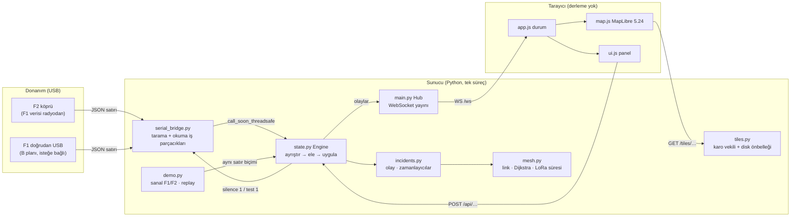
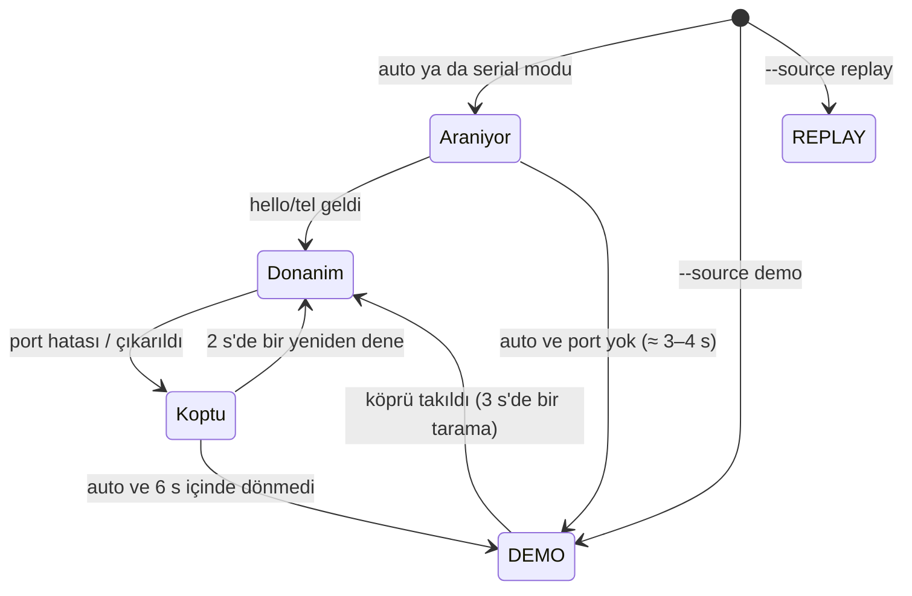
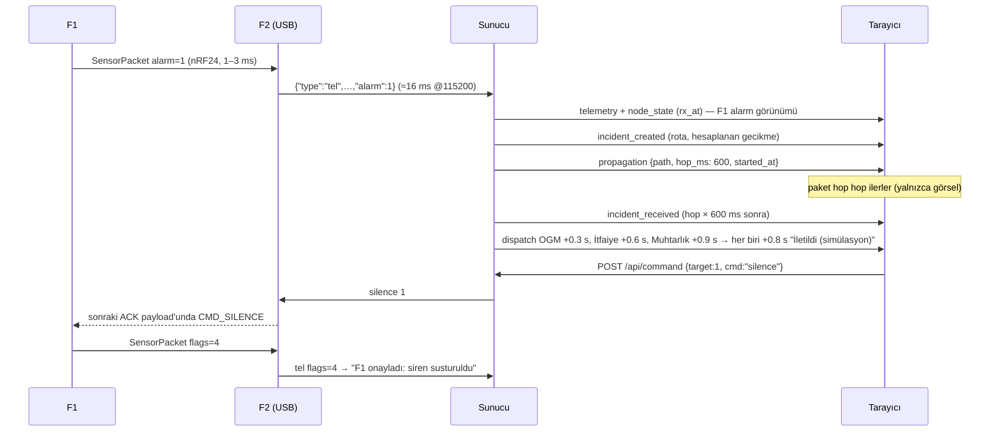

# Mimari

Bu belge simülasyon sunucusunun ve arayüzün nasıl çalıştığını anlatır. Seri/radyo protokolü için tek doğruluk
kaynağı [`PROTOCOL.md`](PROTOCOL.md), donanım için [`HARDWARE.md`](HARDWARE.md)'dir.

## 1. Bileşenler

| Dosya | Sorumluluk |
|---|---|
| `server/protocol.py` | Satır → mesaj (pydantic). `{` ile başlamayan / çözülemeyen satır atlanır. `(node, up, seq)` ile tekrar eleme (10 s pencere). Firmware `printPacketJson` ile birebir aynı satır üreten biçimleyiciler. |
| `server/serial_bridge.py` | Port bulma (VID:PID, sonra ad), `dtr=False, rts=False` ile açma, `status` → `hello`/`tel` yoklaması (2.5 s), çoklu port, okuma iş parçacığı, yeniden bağlanma, Linux/Windows hata ipuçları. |
| `server/demo.py` | Firmware'in örnekleme/alarm/paket/ACK mantığının Python eşi (`VirtualSensor`, `VirtualBridge`), "Simüle Çakmak Tetikle" senaryosu, kayıt oynatıcı (`ReplaySource`). |
| `server/state.py` | `Engine`: tek veri hattı, düğüm durumları, 3.5 s bekçisi, kayıt (200 satır), operatör eylemleri; `Clock`/`FakeClock`, `Scheduler`, `SessionLog`. |
| `server/incidents.py` | Olay yaşam döngüsü: oluştur → rota → paket → MERKEZ → kurumlar; yükselme, kapatma, sıfırlama. |
| `server/mesh.py` | Haversine, link kuralı, görüş hattı (Fresnel + dünya eğriliği), Dijkstra, LoRa hava süresi. |
| `server/terrain.py` | Terrarium çözme, XYZ karo matematiği, DEM mozaiği ve profil. |
| `server/tiles.py` | Karo vekili: disk → üst kaynak (httpx, 8 s), çevrimdışıysa 20 s bekleme, 404. |
| `server/notify.py` | İsteğe bağlı Telegram (yalnızca `.env` varsa). |
| `server/main.py` | FastAPI uygulaması, `Hub`, `Runtime` (kaynak politikası, 20 ms tik), REST/WS uç noktaları. |
| `tools/generate_layout.py` | Gerçek DEM'den deterministik düğüm yerleşimi → `config/nodes.json`. |
| `tools/prefetch_tiles.py` | Çevrimdışı demo için karo ön-yükleme. |
| `tools/vendor_maplibre.py` | MapLibre dağıtım dosyalarını npm paketinden sha512 doğrulamasıyla indirir. |

## 2. Tek veri hattı

Gerçek seri satır, demo satırı ve replay satırı **aynı** fonksiyondan geçer: `Engine.ingest_line(line, origin)`.

1. Ham satır oturum kaydına yazılır (`simulation/data/logs/oturum-*.jsonl`, `--no-log` ile kapatılır).
2. `protocol.parse_line` → mesaj ya da `None` (atla).
3. `tel` ise `Deduper` (aynı paket hem radyodan hem USB'den gelebilir).
4. "Simüle Çakmak Tetikle" donanım/replay üzerinde sürüyorsa gerçek F1 satırları geçici olarak bastırılır;
   gerçek F1'den **alarm** gelirse simülasyon hemen durur (gerçek alarm her zaman önceliklidir).
5. Mesaja göre: düğüm durumu, kayıt satırı, WS olayı; alarm geçişinde `IncidentManager.on_alarm`.

`origin` (`serial` / `demo` / `sim` / `replay`) her kayıt satırına ve olaya etiket olarak taşınır:
`SİMÜLE`, `REPLAY`, ya da BOOT butonu test alarmında `TEST`.

## 3. İş parçacıkları ve zaman

- Motor (`Engine`) yalnızca asyncio döngüsünde çalışır; kilit gerekmez.
- Seri tarama ve okuma ayrı iş parçacıklarıdır. Okuma 2 ms aralıkla `in_waiting` yoklar; satır geldiği an
  `loop.call_soon_threadsafe(engine.ingest_line, …)` ile döngüye aktarılır. Satırın alındığı an (`rx_at`) olaya eklenir.
- 20 ms'lik tik: demo/replay ilerletme, zamanlayıcılar, 3.5 s veri yok bekçisi, simülasyon bitişi.
- Saat enjekte edilebilir (`Clock` / `FakeClock`): testler 50 s'lik senaryoyu milisaniyeler içinde koşturur.

### Kaynak politikası

## 4. Olay akışı ve zamanlama

- **Satır → ekran** süresi tarayıcıda ölçülür: sunucunun satırı okuduğu an (`rx_at`) ile değişikliğin çizildiği kare
  arasındaki fark. Olay panelinde "bu tarayıcıda ölçüldü" diye gösterilir (kabul ölçütü ≤ 150 ms; yazılım
  SwiftShader'lı başsız Chromium'da bile ~5–20 ms ölçüldü).
- **Animasyon süresi gecikme değildir.** Hop başına 600 ms yalnızca izlenebilirlik içindir. Hesaplanan ağ gecikmesi
  ayrı gösterilir: `LoRa hop sayısı × (hava süresi + işlem)`.
- Olay kaynak normale dönse de operatör "Olayı kapat" diyene kadar açık kalır. "Sıfırla" tüm olayları,
  bekleyen zamanlayıcıları (epoch sayacıyla) ve devre dışı düğümleri temizler.

## 5. Mesh modeli

| Konu | Model |
|---|---|
| Link | İki LoRa düğümü arası mesafe ≤ `range_m` (2500 m). F1 yalnızca köprüsü F2'ye bağlıdır (gerçek nRF24). |
| Görüş hattı (varsayılan açık) | DEM profili 30 m adımla; anten = zemin + 4 m direk; 868 MHz 1. Fresnel yarıçapı `√(λ·d1·d2/d)`; dünya kabarıklığı `d1·d2 / (2·k·R)`, k = 4/3. Açıklık < %60 Fresnel ise engelli: > 800 m ise link yok, daha kısaysa cezalı. `area.json → mesh.los.enabled`. Sonuç linklerle birlikte `nodes.json`'a yazılır; sunucu çalışırken DEM gerekmez. |
| Maliyet | `mesafe_km` + 0.5 (mesafe > %80 menzil, zayıf sinyal payı) + 1.0 (engelli kısa link). |
| Rota | Dijkstra (kaynak → MERKEZ); devre dışı düğümler grafa alınmaz; eşitlikte düğüm kimliği. |
| Gecikme | Semtech AN1200.13: `T_sym = 2^SF/BW`, `T_önsöz = (8 + 4.25)·T_sym`, `n_yük = 8 + max(⌈(8·PL − 4·SF + 28 + 16·CRC − 20·IH) / (4·(SF − 2·DE))⌉·(CR + 4), 0)`. SF9, 125 kHz, CR 4/5, 24 B → **205.8 ms** (+20 ms işlem). |

Modellenmeyenler (bilerek): eş zamanlı iletim çakışması, 868 MHz bandının %1 görev döngüsü sınırı
(24 B/SF9 ile düğüm başına saatte ≈ 175 paket), sönümlenme/gürültü, yeniden iletim. Rakamlar "simüle" etiketlidir.

### Yerleşim üretimi (`tools/generate_layout.py`)

1. bbox için z13 Terrarium karoları (~15 m piksel) indirilir, 2×2 ortalamayla ~29 m hücre ızgarası.
2. Topoğrafik konum indeksi (TPI): hücre − 300 m yarıçaplı pencere ortalaması (integral görüntü).
3. Sırt hücresi: dört doğrultudan en az birinde ±60 m içinde en yüksek nokta, TPI ≥ 8 m, rakım ≥ 50 m.
   Vadi tabanı ve çukurlar böylece elenir. Adaylar TPI sırasıyla 150 m'de bir seyreltilir.
4. F1: güneydoğu köşesine yakın, MERKEZ köşesine en uzak sırt noktası. F2: F1'den 300–500 m, bbox merkezine
   doğru ±60° içindeki en yüksek sırt noktası. MERKEZ: kuzeybatı köşesinin 2.5 km'si içindeki en yüksek nokta.
5. Sanal düğümler, görüş hattı açıkken (varsayılan): adaylar arası link grafı kurulur (menzil + LoS kuralı;
   ~50 bin çift, önbellekli). F2 → MERKEZ omurgası bu grafta rastgele ağırlıklı Dijkstra ile bulunur (hop başına
   sabit maliyet az hop'u kayırır); rotadaki her düğüm için önceki ve sonraki düğümü birlikte gören bir yedek
   düğüm eklenir; kalanlar en az iki mevcut düğümü gören sırtlardan, yayılımı artıracak şekilde seçilir.
   Görüş hattı kapalıyken: F2 → MERKEZ koridoru dilimlere bölünür ve her dilimden iki sırt düğümü seçilir.
   Her iki yolda sabit seed ile 400 deneme; kısıtları (bağlı graf, her sanal düğüm ≥ 2 komşu, F1 → MERKEZ 5–9 hop,
   ≥ 600 m aralık) sağlayanlar arasından sırt, yedeklilik (rota düğümü kapanınca alternatif yol) ve yayılım
   puanı en yüksek olan seçilir. Sağlanamazsa aralık 50 m gevşetilir.
6. Görüş hattı, çıktıya yazılan değerlerle (6 ondalık koordinat, tam sayı rakım) hesaplanır; böylece her linkin
   durumu aynı DEM'den birebir yeniden üretilir (`test_terrain.py`).

## 6. REST ve WebSocket

| Uç nokta | Açıklama |
|---|---|
| `GET /` | Arayüz (statik, `Cache-Control: no-cache`) |
| `GET /api/config` | Bölge, kamera, düğümler, linkler, kurumlar, mesh parametreleri, atıflar |
| `GET /api/state` | Anlık görüntü (WS `snapshot` ile aynı) |
| `GET /api/health` | Kaynak, istemci sayısı, karo durumu, oturum kaydı yolu |
| `WS /ws` | Önce `snapshot`, sonra olaylar |
| `POST /api/demo/trigger` | Simüle çakmak (donanım varken geçici sanal F1, `SİMÜLE`) |
| `POST /api/reset` | Olaylar, animasyonlar, devre dışı düğümler sıfırlanır |
| `POST /api/command` | `{target: 1\|2\|"all", cmd: "silence"\|"test"}` → köprüye `silence 1` |
| `POST /api/node/{id}/toggle` | Sanal düğümü devre dışı bırak / etkinleştir, rota yeniden hesaplanır |
| `POST /api/node/{id}/simulate` | Sanal düğümde simüle yangın |
| `POST /api/incident/{id}/close` | Olayı kapat |
| `GET /tiles/{dem\|imagery\|topo}/{z}/{x}/{y}` | Karo vekili (yoksa 404) |

WS olayları: `snapshot`, `telemetry`, `node_state`, `link`, `source_status`, `route`, `propagation`,
`incident_created`, `incident_updated`, `incident_received`, `dispatch`, `incident_closed`, `log`, `reset`.

## 7. Tasarım kararları

- **Derleme adımı yok.** Düz HTML/CSS/ES modülleri; MapLibre 5.24.0 UMD dosyaları repoda (sha512 doğrulamalı).
  v6 yalnızca ESM olduğu için kullanılmadı.
- **Düğümler HTML `Marker`.** Symbol katmanı glyph sunucusu ister ve çevrimdışı çalışmaz. İşaretlere CSS ile
  `position` verilmez: MapLibre'nin mutlak konumlandırmasını ezerse işaretler akışta kayar.
- **`maxBounds` yerine `transformConstrain`.** MapLibre'nin hazır `maxBounds`'u görünümün tamamını kutuya
  sığdırmak için zoom'u ~13.3'e zorlar ve tüm ağ ekrana sığmaz. Bunun yerine kamera merkezi (bbox + %10 pay)
  içinde, zoom 11–16 arasında tutulur; önbellek dışına çıkılmaz.
- **WebGL yoksa** (GPU hızlandırma kapalı) harita alanında açıklayıcı uyarı çıkar; paneller, olay akışı ve
  komutlar çalışmaya devam eder.
- **Kurum bildirimleri simülasyondur**; hiçbir kuruma ileti gitmez. Telegram yalnızca ekibin kendi sohbetine,
  yalnızca `.env` ile.
