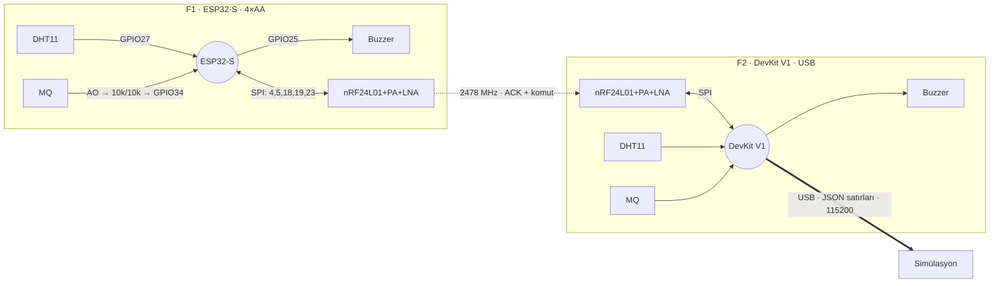

# Donanım: Bağlantılar, Güç ve Demo Hazırlığı

İki fiziksel düğüm **birebir aynı kablolanır**; tek fark beslemedir.

| | F1 · Saha sensör düğümü | F2 · Köprü (gateway) |
|---|---|---|
| Kart | ESP32-S (NodeMCU-32S / ESP-WROOM-32 tabanlı) | ESP32 DEVKIT V1 (DOIT, 30 pin) |
| Besleme | **4×AA kalem pil → 5V/VIN** | **USB (bilgisayar)** — pil yok |
| Firmware | `firmware/node1_sensor` | `firmware/node2_gateway` |
| Görev | Algıla, öt, radyoyla gönder | Al, USB'den JSON olarak aktar, komutları geri ilet |

Görsel şema: `docs/wiring-node1.svg`, `docs/wiring-node2.svg` · etkileşimli sürüm (çevrimdışı açılır): `docs/kablolama.html`.

---

## 1. Stok listesine EK zorunlu parçalar

Bunlar olmadan sistem ya çalışmaz ya da kart zarar görür:

| Parça | Adet | Neden |
|---|---|---|
| 47–100 µF elektrolitik kondansatör (≥ 10 V) | 2 (her nRF24'e 1) | PA+LNA modülü gönderim anında akım çeker; kondansatörsüz `radio.begin()` başarısız olur ya da paket düşer |
| 100 nF seramik kondansatör (104) | 2 | Yüksek frekans gürültüsü (yoksa yalnızca elektrolitik de çoğunlukla yeter) |
| 10 kΩ direnç | 4 (her MQ'ya 2) | MQ çıkışı 5–6 V'a çıkabilir; ESP32 girişi en fazla 3.3 V. Gerilim bölücü şart |
| Jumper kablo, breadboard | — | SPI kablolarını 15 cm'den kısa tutun |

İsteğe bağlı: 10 kΩ (çıplak 4 bacaklı DHT11 için pull-up), 1N4007 diyot (MQ ısıtıcısını ~5.3 V'a indirmek için), BC547/2N2222 + 1 kΩ (sesi kısık çıplak buzzer için), açma/kapama anahtarı (F1 pil hattına).

---

## 2. Pin tablosu (iki node'da aynı)

> **GPIO numarası esastır.** Kart üzerindeki yazı karta göre değişir: DevKit V1'de `D4`, NodeMCU-32S'de `P4`/`IO4`/`4`.

| Modül | Modül pini | ESP32 | DevKit V1 yazısı | ESP32-S yazısı | Not |
|---|---|---|---|---|---|
| **nRF24L01+PA+LNA** | VCC | 3V3 | `3V3` | `3V3` | **Asla 5V değil.** 47 µF + 100 nF, modül pinlerinin dibinde |
| | GND | GND | `GND` | `GND` | |
| | CE | GPIO4 | `D4` | `P4` | |
| | CSN | GPIO5 | `D5` | `P5` | |
| | SCK | GPIO18 | `D18` | `P18` | VSPI |
| | MOSI | GPIO23 | `D23` | `P23` | VSPI |
| | MISO | GPIO19 | `D19` | `P19` | VSPI |
| | IRQ | — | — | — | Boş bırakın |
| **DHT11** | VCC (+) | 3V3 | `3V3` | `3V3` | |
| | DATA (S / OUT) | GPIO27 | `D27` | `P27` | Çıplak sensörse DATA–3V3 arası 10 kΩ |
| | GND (−) | GND | `GND` | `GND` | |
| **MQ gaz modülü** | VCC | 5V hattı | `VIN` | `5V` | Isıtıcı ~150 mA |
| | GND | GND | `GND` | `GND` | |
| | AO | GPIO34 (bölücü üzerinden) | `D34` | `P34` | AO → 10 kΩ → GPIO34 → 10 kΩ → GND |
| | DO | — | — | — | **Bağlamayın** (5–6 V'a çekilidir) |
| **Buzzer** | + / I/O / S | GPIO25 | `D25` | `P25` | Aktif buzzer (üstü etiketli, uzun bacak +) |
| | − / GND | GND | `GND` | `GND` | |
| Durum LED'i | — | GPIO2 | kart üstü | kart üstü | Bağlantı gerekmez |
| Test butonu | — | GPIO0 | `BOOT` | `BOOT`/`IO0` | Yalnızca F1'de etkin |
| **Pil (yalnız F1)** | + | 5V hattı | — | `5V` | 4×AA seri |
| | − | GND | — | `GND` | |

nRF24L01 pin dizilimi (pinler size bakarken, anten karşı tarafta): üst sıra `GND · VCC`, sonra `CE · CSN`, `SCK · MOSI`, `MISO · IRQ`. Kare pedli pin **GND**'dir.

---

## 3. Bağlantı şeması (ASCII)

```
   F1: 4×AA pil (+)      F2: USB 5V
            │                 │
            ▼                 ▼
 ┌─────────────────────────────────────┐
 │ ESP32 (F1: ESP32-S · F2: DevKit V1)  │
 │                                      │
 │ 5V/VIN ●─────────────────────────────┼──────────────────────► MQ VCC
 │        (kart üstü AMS1117 LDO)       │
 │ 3V3    ●───────────────┬─────────────┼──────────────────────► nRF24 VCC ──┬── C1 47µF (+) ─┐
 │                        └─────────────┼──────────────────────► DHT11 VCC   └── C2 100nF ─────┤
 │ GND    ●──── ortak GND ──────────────┼──► nRF24 GND · DHT11 GND · MQ GND · Buzzer − · C1(−) ┘
 │                                      │
 │ GPIO4  ●─────────────────────────────┼──────────────────────► nRF24 CE
 │ GPIO5  ●─────────────────────────────┼──────────────────────► nRF24 CSN
 │ GPIO18 ●─────────────────────────────┼──────────────────────► nRF24 SCK
 │ GPIO23 ●─────────────────────────────┼──────────────────────► nRF24 MOSI
 │ GPIO19 ●◄────────────────────────────┼─────────────────────── nRF24 MISO
 │ GPIO27 ●◄───────────────────────────►┼─────────────────────── DHT11 DATA
 │ GPIO34 ●◄──────┬─────────────────────┼──── R1 10kΩ ────────── MQ AO
 │                └─── R2 10kΩ ── GND   │
 │ GPIO25 ●─────────────────────────────┼──────────────────────► Buzzer +
 │ GPIO2  (kart LED'i) · GPIO0 (BOOT)   │
 └─────────────────────────────────────┘
   ⚠ F2'de pil YOK. ⚠ Pil (>3.6 V) asla 3V3 pinine bağlanmaz.
```



---

## 4. Güç tasarımı

### F1 — 4×AA kalem pil → 5V/VIN

```
 [AA]+[AA]+[AA]+[AA]  = 6.0 V taze · ~5.0 V yarı ömür · 4.4 V sonu
   (+) ──[ anahtar ]──► 5V/VIN ──► kart üstü AMS1117 ──► 3V3 → ESP32 + nRF24 + DHT11
                          └──────► MQ VCC (ısıtıcı doğrudan pil geriliminden)
   (−) ─────────────────► GND
```

- **Neden 4 pil?** Kart üstü regülatör (AMS1117) ~1.1 V düşürür; 3.3 V için girişte ≥ 4.4 V gerekir.
  3×AA yükte 4.0 V'a iner → 3.3 V hattı çöker → ESP32 resetlenir (özellikle nRF24 gönderirken).
- **Neden 2 pil 3V3'e olmaz?** 2×AA yükte 2.4 V'a iner (ESP32 modülü 3.0–3.6 V ister) ve MQ ısıtıcısı 5 V ister.
- **Asla** 4 pili 3V3 pinine bağlamayın: 6 V, ESP32'yi ve nRF24'ü yakar.
- MQ ısıtıcısı 6 V'ta (taze pil) spesifikasyonun (5.0 V ± 0.1 V) ~%20 üstünde çalışır: demo süresi için sorun değildir.
  Daha doğrusu: MQ VCC hattına seri bir **1N4007** (≈5.3 V) ya da 4×**NiMH** şarjlı pil (4.8–5.2 V).
- Yükleme yaparken pilleri çıkarın (USB ve pil aynı anda 5V hattına bağlanmasın).

### F2 — USB

- USB 2.0 portu 500 mA verir; F2'nin tüketimi ~300 mA. Doğrudan dizüstü portuna takın (beslemesiz hub'a değil).
- **F2'ye pil bağlamayın.** Birçok DevKit klonunda USB 5V ile VIN arasında koruma diyotu yoktur; pil USB portuna geri besleme yapabilir.

### Akım bütçesi

| Yük | F1 tipik | F1 tepe | F2 tipik |
|---|---|---|---|
| ESP32 (F1: 80 MHz, Wi-Fi kapalı) | ~30 mA | ~50 mA | ~50 mA (240 MHz) |
| nRF24L01+PA+LNA | < 1 mA bekleme | 40–115 mA (ms'lik gönderim darbeleri) | ~45 mA (sürekli dinler, LNA açık) |
| MQ ısıtıcısı | ~150 mA (5 V) / ~180 mA (6 V) | | ~150 mA |
| DHT11 | ~1 mA | 2.5 mA | ~1 mA |
| Buzzer (alarmda) | 0 | ~30 mA | 0 |
| Kart LED'leri + LDO | ~10 mA | | ~10 mA |
| **Toplam** | **~220 mA** | **~350 mA** | **~260–300 mA** |

4×AA alkalin, ~220 mA'de yaklaşık **5–7 saat** dayanır. Demo günü yeni pil takın ve yedek set bulundurun.

---

## 5. Bileşen notları

**nRF24L01+PA+LNA**
- Kondansatörü modül pinlerinin dibine koyun (+ bacak VCC, şeritli bacak GND).
- Anteni takmadan modüle güç vermeyin.
- Masa üstünde iki modülü ≥ 1 m ayırın. Yakın mesafede paket kaybı olursa firmware'de `RF_PA_LEVEL` → `RF24_PA_MIN`.
- Uzun menzil (PA_HIGH/MAX) için: PA bölümünü (anten hariç) yalıtım bandı + alüminyum folyo ile sarıp folyoyu GND'ye bağlayın.
- SPI kabloları kısa olsun; firmware bu yüzden SPI'yi 4 MHz'te çalıştırır.

**MQ gaz sensörü**
- AO bölücüsü zorunludur. DO pinini bağlamayın.
- Isınma: güç verdikten sonra en az **2–3 dakika** bekleyin. Firmware ilk 45 s gaz alarmı vermez (LED yavaş yanıp söner).
- MQ-2, MQ-5, MQ-6 çakmak gazına (bütan) çok iyi tepki verir. MQ-135 daha zayıftır. MQ-7/MQ-9 da tepki verir ama
  `GAS_DELTA_MV` değerini düşürmeniz gerekebilir. Seri monitörde `gas` ile `base` farkına bakarak ayarlayın.
- Isıtıcı ısınır (normaldir); DHT11'i MQ'dan en az 3 cm uzağa koyun.

**DHT11**
- 0–50 °C ölçer, ±2 °C, **yavaş** tepki verir (5–30 s). Hızlı tetik MQ'dur; DHT11 ısıyı doğrular (gaz + ısı = YANGIN).
- Plastik gövde erir: alevi DHT11'e değdirmeyin, ~5 cm altta birkaç saniye tutun.
- 3 bacaklı modüllerde pin sırası üreticiye göre değişir — üzerindeki `+ / S / −` yazılarına göre bağlayın.

**Buzzer**
- Aktif buzzer (üstü etiketli, uzun bacak +): `GPIO25 → +`, `− → GND`.
- 3.3 V'ta sesi kısıksa NPN ile sürün: `GPIO25 → 1 kΩ → BC547 beyz`, emiter → GND, kolektör → buzzer −, buzzer + → 5V/VIN.
- Modülün üstünde "low level trigger" yazıyorsa firmware'de `BUZZER_ON_LEVEL LOW`.
- Pasif buzzer (etiketsiz, sadece PWM ile öter) ise `BUZZER_IS_ACTIVE 0`.

---

## 6. Güç vermeden önce kontrol listesi

- [ ] nRF24 VCC → **3V3** (VIN/5V değil)
- [ ] nRF24 VCC–GND arasında kondansatör, kutuplar doğru
- [ ] Anten takılı
- [ ] CE=GPIO4, CSN=GPIO5 ters değil; MOSI=GPIO23, MISO=GPIO19 ters değil
- [ ] MQ AO → 10 kΩ / 10 kΩ bölücü → GPIO34; DO boş
- [ ] Tüm GND'ler ortak
- [ ] F1: pil + → 5V/VIN, − → GND; yükleme sırasında piller çıkarılmış
- [ ] F2: pil yok, yalnızca USB
- [ ] İki karta aynı firmware sürümü (aynı `PROTO_VERSION`, kanal ve adres) yüklenmiş

---

## 7. Firmware yükleme

**PlatformIO (önerilen):**
```bash
cd firmware/node1_sensor  && pio run -t upload    # F1 (ESP32-S) USB'ye takılıyken
cd firmware/node2_gateway && pio run -t upload    # F2 (DevKit V1) USB'ye takılıyken
```

**Arduino IDE 2:** Kart yöneticisinden *esp32 by Espressif* kurun. Kütüphane yöneticisinden **RF24** (TMRh20),
**DHT sensor library** (Adafruit, bağımlılıklarıyla birlikte) kurun. Yeni sketch açıp ilgili `main.cpp` içeriğini yapıştırın.
Kart: F1 için *ESP32 Dev Module*, F2 için *DOIT ESP32 DEVKIT V1*.

**Açılış teşhisi:** 1 kısa bip = hazır, 3 kısa bip = nRF24 bulunamadı.

**Bilgisayarsız mantık testi:** `bash firmware/test_host/run.sh` (gerçek firmware, taklit donanımla senaryo koşturur).

**Donanım testi:** `python firmware/tools/seri_test.py` — portu bulur, köprünün satırlarını okunur biçimde yazar.

---

## 8. Jüri demosu — adım adım

1. **5 dk önce:** F1'e pilleri takın (1 bip), F2'yi USB'ye takın (1 bip), simülasyonu başlatın. MQ ısınması için bekleyin.
2. **Gaz (en hızlı, en güvenli):** Çakmağı **yakmadan** gaz düğmesine 1–2 s basın, MQ'ya 2–3 cm mesafeden.
   → F1 buzzer'ı < 1 s içinde öter → F2 iki kısa bip (kablosuz teslim) → ekranda F1 kırmızı → paket sanal mesh'te ilerler → Merkez → OGM / İtfaiye / Muhtarlık.
3. **Isı (isteğe bağlı):** 30 s sonra, yanan çakmağı DHT11'in ~5 cm altında 5–10 s tutun → durum YANGIN (gaz + ısı).
   Gaz bıraktığınız noktada çakmağı ateşlemeyin.
4. **Çift yönlü bağlantı:** Arayüzden "Sahadaki sireni sustur" → F1 buzzer'ı bir sonraki pakette (≤ 0.3 s) susar.
5. **B planı:** MQ tepki vermezse F1'in BOOT butonuna 1 s basın (test alarmı, kayıtta "test" görünür).
   Radyo çalışmazsa F1'i USB ile bilgisayara bağlayın; sunucu onu doğrudan okur (`via:"usb"`).
6. Salonda açık ateş yasaksa yalnızca 2. adımı kullanın.

---

## 9. Sorun giderme

| Belirti | Olası neden | Çözüm |
|---|---|---|
| Açılışta 3 bip / `"radio":0` | nRF24 VCC 5V'ta, CE/CSN ya da MISO/MOSI ters, kondansatör yok, gevşek jumper | Kontrol listesini tekrar yapın |
| F2 hiç `"via":"rf"` basmıyor | F1 kapalı, iki kartta farklı firmware/kanal, modüller dip dibe ve PA yüksek | Aynı firmware, `RF24_PA_MIN`, 1 m ayırın |
| `lq` sürekli < 80 | Wi-Fi kalabalığı, besleme gürültüsü | Kondansatör, kanalı iki firmware'de birlikte değiştirin |
| `gas` hiç değişmiyor | MQ VCC 5V'a bağlı değil, AO yerine DO bağlı, ısınmadı | Bağlantı + 2–3 dk bekleyin |
| `t`/`h` hep `null` | DHT11 DATA bağlantısı, pull-up yok | GPIO27 ve 10 kΩ pull-up |
| Buzzer hep çalıyor / hiç çalmıyor | Düşük seviye tetiklemeli modül | `BUZZER_ON_LEVEL LOW` |
| Ubuntu'da `/dev/ttyUSB0` görünmüyor | `brltty` CH340 çipini kapıyor | `sudo apt remove brltty`, kartı çıkarıp takın |
| `Permission denied: /dev/ttyUSB0` | Kullanıcı `dialout` grubunda değil | `sudo usermod -aG dialout $USER`, oturumu kapatıp açın |
| Windows'ta COM portu yok | Sürücü eksik | CH340 (WCH) veya CP210x (Silicon Labs) sürücüsü |
| `Failed to connect to ESP32` | Kart otomatik boot moduna girmedi | Yükleme başlarken BOOT butonunu basılı tutun |
| Port meşgul | Seri monitör açık | Arduino IDE / `pio device monitor` kapatın |
