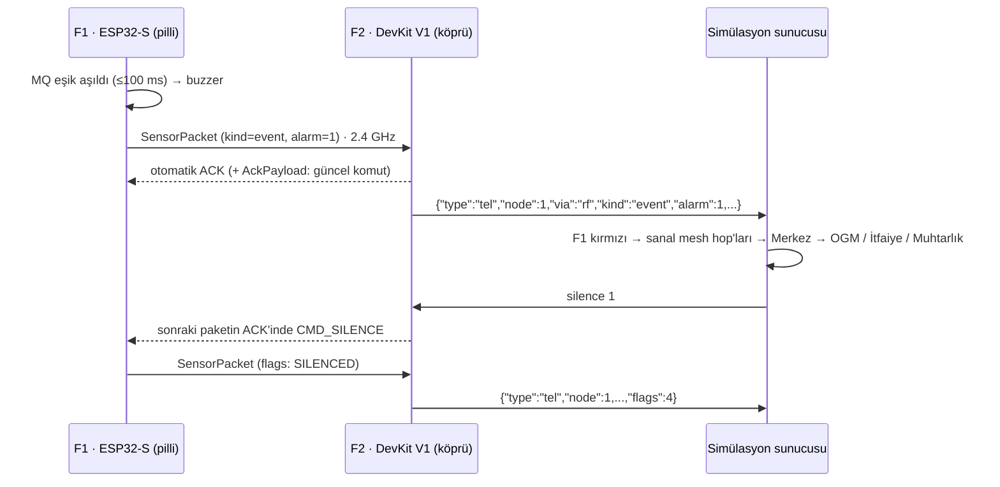

# Haberleşme Protokolü

Bu belge **tek doğruluk kaynağıdır**: firmware (`firmware/*/src/main.cpp`) ve simülasyon sunucusu buna uyar.
İki katman vardır:

1. **Radyo katmanı** — F1 (saha düğümü) → F2 (köprü), nRF24L01+PA+LNA, ikili paket.
2. **Seri katman** — F2 (ve isteğe bağlı F1) → bilgisayar, USB üzerinden satır başına bir JSON.



---

## 1. Radyo katmanı (nRF24L01+)

| Ayar | Değer | Not |
|---|---|---|
| Kanal | **78** (2478 MHz) | ISM 2400–2483.5 MHz içinde; Wi-Fi 1/6/11 ve BLE reklam kanallarının (2402/2426/2480) dışında |
| Veri hızı | 1 Mbps | Klon çiplerle en uyumlu hız |
| Güç | `RF24_PA_LOW` | Masa üstünde PA_MAX alıcıyı doyurur |
| CRC | 16 bit | |
| Auto-ACK | açık | 15 yeniden deneme, 1.5 ms aralık |
| Yük boyu | dinamik | ACK payload için zorunlu |
| Adres | `"OYMA1"` (5 bayt) | F1 yazma borusu = F2 okuma borusu 1 |

### 1.1 `SensorPacket` — 22 bayt, little-endian, `packed`

| Ofset | Alan | Tip | Açıklama |
|---|---|---|---|
| 0 | `proto` | u8 | Protokol sürümü = **1** |
| 1 | `nodeId` | u8 | 1 = F1, 2 = F2 |
| 2 | `type` | u8 | 0 = periyodik, 1 = olay (alarm değişti), 2 = açılış |
| 3 | `alarm` | u8 | bit0 = GAZ, bit1 = ISI → 0 normal, 1 gaz, 2 ısı, 3 **yangın** |
| 4 | `flags` | u8 | bit0 ısınıyor · bit1 DHT hatası · bit2 susturuldu · bit3 test |
| 5 | `txFail` | u8 | Son başarılı gönderimden beri başarısız deneme (255'te doyar) |
| 6 | `seq` | u16 | Her pakette +1 |
| 8 | `uptimeMs` | u32 | Açılıştan beri ms |
| 12 | `tempX10` | i16 | °C × 10 (−32768 = geçersiz) |
| 14 | `humX10` | u16 | %RH × 10 (65535 = geçersiz) |
| 16 | `gasMv` | u16 | MQ AO gerilimi, mV (bölücü telafi edilmiş) |
| 18 | `gasBaseMv` | u16 | MQ uyarlanabilir taban, mV |
| 20 | `vbatMv` | u16 | Pil gerilimi, mV (0 = ölçülmüyor) |

### 1.2 `AckPayload` — 4 bayt (F2 → F1, ACK paketinin içinde)

| Ofset | Alan | Açıklama |
|---|---|---|
| 0 | `proto` | 1 |
| 1 | `cmdSeq` | Köprü her yeni komutta +1; F1 yalnızca değiştiğinde uygular |
| 2 | `cmd` | 0 yok · 1 SUSTUR · 2 TEST BİP |
| 3 | `target` | 1 (F1) |

F2, FIFO'da her zaman **tek, güncel** bir ACK payload tutar (`flush_tx` + `writeAckPayload`).
Komut F1'e, F1'in bir sonraki paketiyle ulaşır: normalde ≤ 1 s, alarmda ≤ 0.3 s.
F1 açıldıktan sonra gördüğü ilk ACK'teki komutu **çalıştırmaz** (eski komut tekrar uygulanmasın diye).

### 1.3 Zamanlama

| Olay | Süre |
|---|---|
| MQ örnekleme | 100 ms (8 örnek ortalaması) |
| DHT11 okuma | 2.1 s |
| Periyodik paket | 1 s · alarm sürerken 0.3 s |
| Alarm değişimi | **anında** `event` paketi (3 deneme) |
| MQ ısınma | ilk 45 s gaz alarmı yok (`flags` bit0) |
| Bağlantı koptu | F2, F1'den 3.5 s paket alamazsa `link lost` |

### 1.4 Alarm mantığı (iki node'da aynı)

- **GAZ**: `gas ≥ max(base + 350 mV, base × 1.4)` ve ısınma bitmiş. Söner: `gas < base + 175 mV` 4 s boyunca.
- **ISI**: `t ≥ 45 °C` veya `t − t_taban ≥ 6 °C`. Söner: ikisi de 2 °C altına inip 6 s boyunca kalırsa.
- Tabanlar yalnızca alarm yokken yavaşça güncellenir (MQ ~50 s, sıcaklık ~40 s zaman sabiti).
- Yeni alarm başlayınca ya da alarm bitince susturma sıfırlanır.

---

## 2. Seri katman (USB → bilgisayar)

- **115200 baud, 8N1, UTF-8**, satır sonu `\n`.
- Her satır **tek bir JSON nesnesidir**. `{` ile başlamayan veya JSON olarak çözülemeyen satırları **sessizce atlayın**
  (ESP32 açılışta ROM mesajları basar).
- Portu açarken **DTR=False, RTS=False** ayarlayın; aksi hâlde bazı kartlar yeniden başlar.
- Tekrar eden satırları `(node, up, seq)` üçlüsüyle eleyin (F1 hem radyodan hem USB'den gelebilir).

### 2.1 Mesaj tipleri (cihaz → bilgisayar)

| `type` | Ne zaman | Alanlar |
|---|---|---|
| `hello` | açılışta, `status` komutunda | `role` (`gateway`/`sensor`), `node`, `fw`, `proto`, `radio` (1/0), `ch` |
| `tel` | her ölçüm paketi | aşağıdaki tablo |
| `link` | F1 bağlantısı koptu/döndü | `node`, `state` (`lost`/`ok`), `age_ms` |
| `gw` | 5 s'de bir (köprü) | `up`, `radio`, `ch`, `rx`, `lost`, `lq` (−1 = veri yok), `n1_link` (`ok`/`lost`/`never`), `n1_age_ms` (−1 = hiç) |
| `cmd` | komut yanıtı | `ok`, `cmd`, `target`, `note` |
| `pong` / `help` | `ping` / `help` komutu | |
| `log` | bilgi/uyarı/hata | `node`, `level` (`info`/`warn`/`error`), `msg` |

### 2.2 `tel` alanları

| Alan | Tip | Açıklama |
|---|---|---|
| `node` | int | 1 = F1 (saha), 2 = F2 (köprü) |
| `via` | str | `rf` (F1 verisi köprüden), `local` (köprünün kendi sensörü), `usb` (F1 doğrudan USB'de — B planı) |
| `kind` | str | `periodic`, `event` (alarm değişti), `boot` |
| `seq` | int | Paket sıra numarası |
| `up` | int | Node açılışından beri ms |
| `t` | float/null | Sıcaklık °C |
| `h` | float/null | Bağıl nem % |
| `gas` | int | MQ AO gerilimi (mV) |
| `base` | int | MQ taban (mV) — `gas − base` farkı göstergedir |
| `alarm` | int | 0 NORMAL · 1 GAZ · 2 ISI · 3 YANGIN |
| `flags` | int | 1 ısınıyor · 2 DHT hatası · 4 susturuldu · 8 test (bit maskesi) |
| `vbat` | int | Pil mV (0 = ölçülmüyor → arayüzde "—") |
| `txf` | int | F1'in teslim edemediği paket sayısı (radyo sorunu göstergesi) |
| `lq` | int | Yalnızca `via:"rf"`: son paketlere göre bağlantı kalitesi % |
| `rf_ok` | int | Yalnızca `via:"usb"`: bu paket radyoyla da teslim edildi mi |

**Gerçek örnekler** (firmware'in bilgisayar üzerinde koşturulmasıyla üretildi — `docs/ornek_seri_kayit.tsv`):

```json
{"type":"hello","role":"gateway","node":2,"fw":"1.0.0","proto":1,"radio":1,"ch":78}
{"type":"tel","node":1,"via":"rf","kind":"periodic","seq":60,"up":60000,"t":24.0,"h":45.0,"gas":309,"base":324,"alarm":0,"flags":0,"vbat":0,"txf":0,"lq":100}
{"type":"tel","node":1,"via":"rf","kind":"event","seq":61,"up":60300,"t":24.0,"h":45.0,"gas":776,"base":324,"alarm":1,"flags":0,"vbat":0,"txf":0,"lq":100}
{"type":"cmd","ok":true,"cmd":"silence","target":"1","note":"F1'in bir sonraki paketinin ACK'i ile iletilecek"}
{"type":"tel","node":1,"via":"rf","kind":"periodic","seq":81,"up":66300,"t":24.0,"h":45.0,"gas":1106,"base":324,"alarm":1,"flags":4,"vbat":0,"txf":0,"lq":100}
{"type":"link","node":1,"state":"lost","age_ms":3501}
{"type":"link","node":1,"state":"ok","age_ms":6300}
{"type":"gw","node":2,"up":110000,"radio":1,"ch":78,"rx":197,"lost":20,"lq":71,"n1_link":"ok","n1_age_ms":800}
```

### 2.3 Komutlar (bilgisayar → F2), satır sonu `\n`, büyük/küçük harf duyarsız

| Komut | Etki |
|---|---|
| `silence 1` | F1 buzzer'ı alarm bitene kadar susar (ACK payload ile) |
| `silence 2` | Köprünün kendi buzzer'ı susar |
| `silence all` | İkisi birden |
| `test 1` / `test 2` | 3 kısa bip (bağlantı testi) |
| `status` | `hello` + `gw` satırı |
| `ping` | `pong` |
| `help` | komut listesi |

### 2.4 Uçtan uca gecikme bütçesi (gerçek donanım)

| Adım | Süre |
|---|---|
| Butan → MQ direnci düşer | 0.3–2 s (fiziksel, sensöre bağlı) |
| Firmware eşiği yakalar | ≤ 100 ms |
| Buzzer başlar | aynı döngü (radyodan önce) |
| nRF24 teslim (ACK dahil) | 1–3 ms |
| F2 seri satır (≈180 bayt @115200) | ≈ 16 ms |
| Sunucu → tarayıcı (WebSocket) | < 10 ms |
| **Elektronik toplam** | **≈ 30–130 ms** |

Sanal mesh hop'ları bundan sonra **simülasyondur** ve arayüzde böyle etiketlenir.
